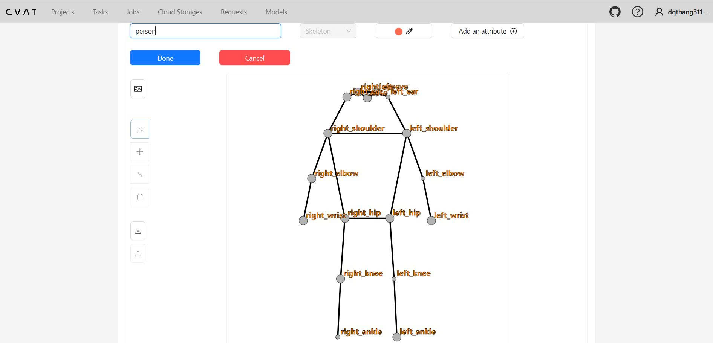
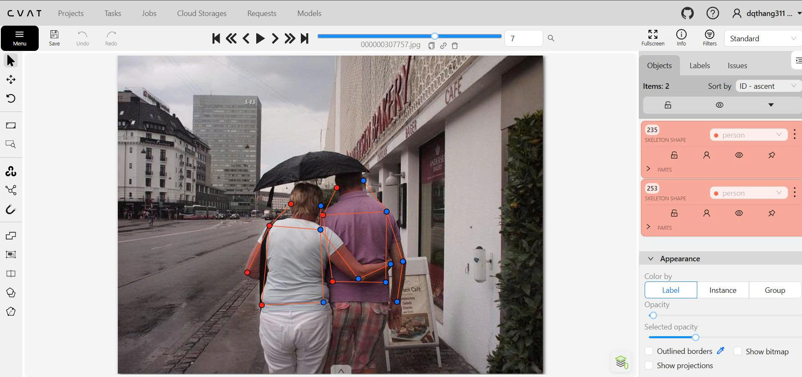
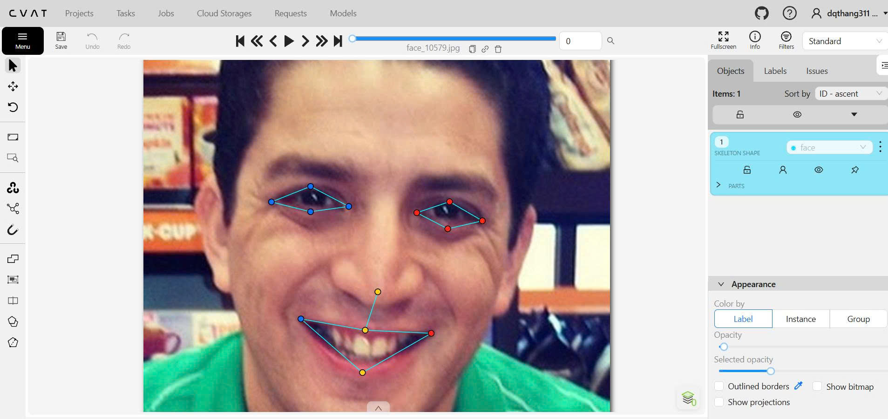
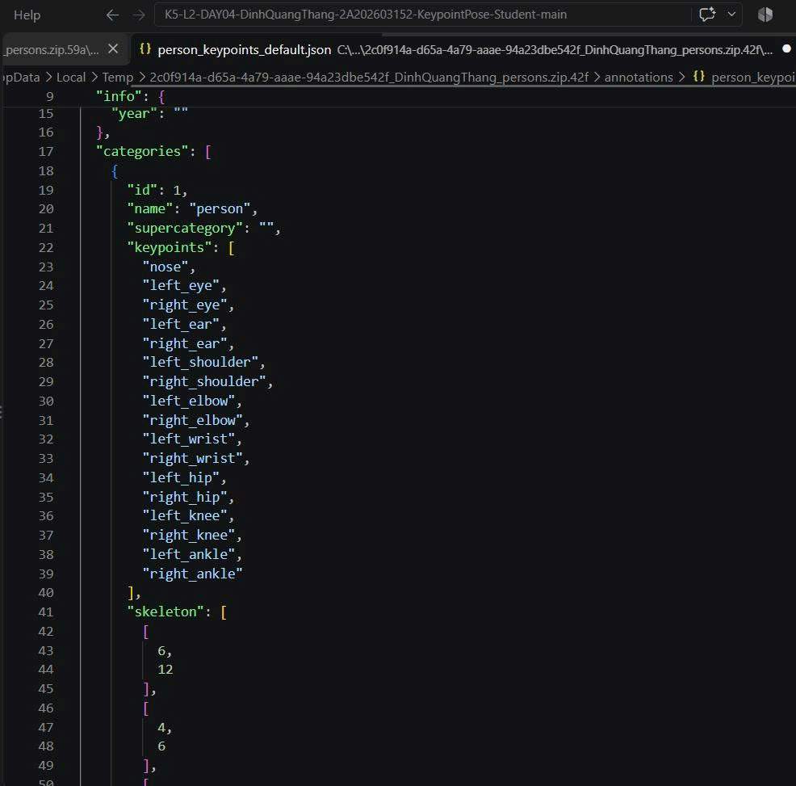

# Báo cáo cá nhân — ĐINH QUANG THẮNG — 2A202603152

Dữ liệu: 12 ảnh người COCO val2017 (Lin et al., 2014) và 8 ảnh khuôn mặt chuẩn hóa cho lab, chỉ dùng trong lớp.

## 0. Thông tin học viên

- Họ tên: ĐINH QUANG THẮNG
- MSSV: 2A202603152
- Email: dqthang311@gmail.com
- Email VinUni: 26ai.thangdq4@vinuni.edu.vn
- Link repository: https://github.com/quangthang311/K5-L2-DAY04-DinhQuangThang-2A202603152-KeypointPose-Student
- Phiên bản CVAT (Help → About): v2.74.1
- Máy: hệ điều hành Windows 11 · RAM 16 GB · chạy CVAT chế độ đầy đủ
- Bộ ảnh (`src/exports/assignment.json` do `lab.py setup` tạo): Đã có
- Giờ bắt đầu:
- Giờ kết thúc:

## 1. Kiểm tra label (CP0)

| Label | Kiểu | Số điểm | Tên điểm đúng bảng của lab? | Đúng thứ tự? | Số cạnh |
|---|---|---:|---|---|---:|
| `person` | skeleton | 17 | Có | Có | 19 |
| `face` | skeleton | 13 | Có | Có | 13 |

Mẫu `person` dựng theo người quay mặt về camera (các điểm `left_*` nằm bên phải khung mẫu): Có.

Cách đổi cờ `occluded` / `outside` cho một điểm trên phiên bản CVAT này: chọn điểm -> bật `occluded` nếu điểm bị che nhưng vẫn ước lượng được, bật `outside` nếu điểm nằm ngoài khung ảnh hoặc không nằm trong ảnh hoặc không thế ước lượng được, sau đó khi xuất JSON, `outside` sẽ tương ứng với `v = 0` và `occluded` tương ứng với `v = 1`.

## 2. Số lượng đã gán và thời gian (CP1, CP2)

| Nhóm ảnh | Số ảnh | Số skeleton đã gán | Số người dưới 60 px (không gán) | Số poster / gương / màn hình bỏ qua | Thời gian (phút) |
|---|---:|---:|---:|---:|---:|
| `easy` | 5 | 5 | 0 | 0 |  |
| `occluded` | 3 | 6 | 0 | 0 |  |
| `back` | 2 | 4 | 0 | 0 |  |
| `small` | 1 | 3 | 0 | 0 |  |
| `crowd` | 1 | 3 | 1 | 0 |  |
| `faces` | 8 | 8 | — | 0 |  |

- Số ảnh người đã xong ở mốc phút 105: 10 / 10
- Thời gian thực tế (phút): CP1 60P, CP2 30p, CP3 30p.
- Ảnh tốn thời gian nhất là ảnh `000000043500.jpg`, vì sao phần lớn các bộ phận đều bị che và hình còn là màu đen trắng.

## 3. Bảng ca khó (CP1, CP2)

Mỗi điểm bạn phân vân một dòng, nhất là phân vân giữa `v = 1` và `v = 0`, hoặc không chắc hướng người.

| Ảnh | Người / mặt | Điểm | Cờ đã chọn | Phân vân giữa | Lý do chọn |
|---|---|---|---:|---|---|
| `000000241837.jpg` | Người | Cặp mắt | `v = 0`  | `v = 0` / `v = 1` | Do không thể nhìn thấy mắt của person nên không có thể ước lượng được vị trí của mắt. |
| `000000122199.jpg` | Người | Gối và cổ chân | Không xác định được | `lr_swap` / chân bắt chéo thật | Cặp gối/cổ chân nằm ngược phía; cần lần theo từng chân trên ảnh.|
| `000000122199.jpg` | Người | `left_shoulder` | `v=1` | `v = 0` / `v = 1` | Các điểm `v=1` ở sát mép, cần xác định các khớp nằm ở đâu để ước lượng. |

## 4. Bảng tự review (CP3)

Đi từ ảnh cuối về ảnh đầu. 5 ảnh người (ít nhất 2 ảnh `back` hoặc `crowd`) và 3 ảnh mặt. Ít nhất 8 dòng, kể cả dòng `ok`. Ghi lỗi trước, sửa sau.

Mã lỗi dùng đúng một trong: `lr_swap`, `vis_flag`, `position`, `missing`, `extra`, `ok`.

| Ảnh | Người / mặt | Điểm | Mã lỗi | Ghi chú | Đã sửa? |
|---|---|---|---|---|---|
| `000000507223.jpg` | Người | position | `lr_swap` | Đổi trái/phải nhầm khi người quay lưng | Đã tiến hành sửa |
| `000000565600.jpg` | Người |  | `vis_flag` | `v` đặt sai khi điểm bị che nhưng vẫn ước lượng được | Đã tiến hành sửa |

## 5. Kiểm file xuất và kết quả tự kiểm (CP4)

Tự kiểm tay trong file JSON:

| File | Người / mặt kiểm (ảnh, thứ tự) | Số phần tử `keypoints` | Điểm `outside` ra `v = 0`, `occluded` ra `v = 1`? | `num_keypoints` khớp? |
|---|---|---:|---|---|
| `DinhQuangThang_persons.zip` | `000000130816.jpg` | 51 | Có | Có |
| `DinhQuangThang_persons.zip` | `000000164659.jpg` | 51 | Có | Có |
| `DinhQuangThang_faces.zip` | `face_10579.jpg` | 39 | Có | Có |

Sau khi xuất, CVAT ghi `occluded` thành `v = 1` và `outside` thành `v = 0`. Tọa độ của điểm `outside` trong file là `0, 0` (không giữ tọa độ cũ).

Hai job đã chuyển sang completed trên CVAT? Đã chuyển qua Completed.

Dán phần TÓM TẮT in ra từ `python src\check_submission.py --persons src\exports\DinhQuangThang_persons.zip --faces src\exports\DinhQuangThang_faces.zip`:

```text

----- TÓM TẮT (dán vào báo cáo mục 5) -----
- File person: DinhQuangThang_persons.zip
  Số ảnh: 12 · số skeleton `person`: 21 · mỗi annotation 51 số
  Skeleton theo ảnh: 000000043500=2, 000000122199=2, 000000130816=3, 000000162046=1, 000000164659=1, 000000241837=1, 000000269462=3, 000000307757=2, 000000324953=2, 000000336477=1, 000000393909=2, 000000455536=1
  Cờ v: v=2 209 (59%) · v=1 42 (12%) · v=0 106 (30%)
  num_keypoints trung bình: 12.0
- File face: DinhQuangThang_faces.zip
  Số ảnh: 8 · số skeleton `face`: 8 · mỗi annotation 39 số
  Skeleton theo ảnh: face_10579=1, face_125051=1, face_141135=1, face_301643=1, face_416730=1, face_436791=1, face_483667=1, face_81239=1
  Cờ v: v=2 96 (92%) · v=1 0 (0%) · v=0 8 (8%)
  num_keypoints trung bình: 12.0
- Ghi chú: 114 điểm v = 0 vẫn mang tọa độ cũ (CVAT 2.x xuất như vậy; chuẩn COCO ghi 0, 0). Không phải lỗi: điểm v = 0 bị bỏ qua khi huấn luyện và khi chấm.
- Số [LỖI]: 0 · số [CẢNH BÁO]: 2
Kết quả: ĐẠT (đọc lại từng cảnh báo ở trên)
```

Các `[CẢNH BÁO]` còn giữ nguyên và lý do:

- Cảnh báo `000000130816.jpg #3`: ảnh có người nhỏ hơn 60 px nên không gán theo quy định của lab; cảnh báo này không sửa vì khớp đó không đủ độ lớn để tính nhãn.
- Cảnh báo `000000164659.jpg #1`: cặp knee/ankle bị ngược so với các cặp còn lại; cảnh báo này được giữ để kiểm tra lại trái/phải và xác nhận nhãn có đúng hướng người hoặc không.

## 6. Ảnh chụp màn hình

1. Label `person` trong label constructor (đủ 17 điểm có tên):

   

2. Một người quay lưng đã gán, cờ đã đặt:

   

3. Một khuôn mặt đã gán 13 điểm, phóng to vùng mắt:

   

4. Một đoạn JSON xuất của một người:

   


## 7. Tự đánh giá

1. Lỗi bạn mắc nhiều nhất hôm nay, và cách bạn sẽ tránh ở dự án thật:

   => Lỗi nhiều nhất thường là gán nhầm trái/phải hoặc đặt `v` sai cho điểm bị che. Trong dự án thật, dùng quy tắc “trái/phải theo người trong ảnh” và kiểm lại bằng cách đối chiếu với đường giữa thân / mặt trước khi export.

2. Một quy tắc bạn đề xuất thêm vào guideline (kèm ảnh ví dụ nếu có):

   => Quy tắc “đối với điểm chỉ nhìn thấy một góc nhỏ nhưng vẫn còn nửa đường cong, ưu tiên giữ `v = 1` thay vì `v = 0` nếu có thể ước lượng được vị trí; nếu không chắc, đánh dấu `v = 0` và xem xét lại.”

3. Nhãn của bạn đi vào model ở đâu? Chọn một lỗi bạn đã sửa và nói nó sẽ làm model học sai thế nào (heatmap, trọng số trong loss, hay bước lật ảnh):

   => Nếu điểm mắt bị đổi trái/phải hoặc gán sai vị trí, heatmap của điểm đó sẽ lệch khỏi đối tượng thật, gây nhiễu trong loss và làm model học nhầm hướng trái/phải, đặc biệt khi lật ảnh hoặc tăng dữ liệu.

## 8. Khó khăn và lỗi kỹ thuật

=> Khó khăn lớn nhất là xác định `v` ở các điểm bị che hoặc bị chồng lên bởi các bộ phận khác; đồng thời phải kiểm tra lại 17 điểm / 13 điểm đúng nhãn và đúng hướng người. Một lỗi kỹ thuật thường gặp là export file mà mảng `keypoints` sai số lượng hoặc `num_keypoints` không khớp; cần chạy lại script kiểm trước khi nộp.

## Bonus (nếu làm)

### B1 — 3 ảnh người khó thêm

| Ảnh | Số skeleton | Số người dưới 60 px | Ca khó nhất |
|---|---:|---:|---|
| `000000254060.jpg` | 1 | 0 | Không |
| `000000507223.jpg` | 3 | 0 | Có |
| `000000565600.jpg` | 2 | 0 | Không |

Kết quả `src/check_submission.py` cho `DinhQuangThang_bonus_persons.zip`:

```text

----- TÓM TẮT (dán vào báo cáo mục 5) -----
- File person: DinhQuangThang_bonus_persons.zip
  Số ảnh: 3 · số skeleton `person`: 6 · mỗi annotation 51 số
  Skeleton theo ảnh: 000000254060=1, 000000507223=3, 000000565600=2
  Cờ v: v=2 74 (73%) · v=1 2 (2%) · v=0 26 (25%)
  num_keypoints trung bình: 12.7
- Ghi chú: 26 điểm v = 0 vẫn mang tọa độ cũ (CVAT 2.x xuất như vậy; chuẩn COCO ghi 0, 0). Không phải lỗi: điểm v = 0 bị bỏ qua khi huấn luyện và khi chấm.
- Số [LỖI]: 0 · số [CẢNH BÁO]: 1
Kết quả: ĐẠT (đọc lại từng cảnh báo ở trên)
```

### B2 — 5 ảnh khuôn mặt đen trắng / hồng ngoại

Ảnh không màu khó hơn ở điểm nào? Kính râm trên ảnh hồng ngoại có còn là `v = 1` không?

=> Khó nhất là vùng mắt và mũi vì độ tương phản thấp trên ảnh đen trắng / hồng ngoại. Trong bonus zip `DinhQuangThang_bonus_faces.zip`, các ảnh đều có 1 mặt mỗi ảnh, `v=2` chiếm 88%, `v=1` chiếm 12%, `v=0` bằng 0. Điều này cho thấy nếu kính râm che gần hết vùng mắt nhưng vẫn còn thể ước lượng được hình học của mắt, nên giữ `v = 1`; chỉ khi không còn xác định được vị trí thì mới đánh `v = 0`.

### B3 — Model so với nhãn của tôi (không tính điểm)

- Demo đã dùng: KHÔNG CÓ
- Ảnh đã thử: KHÔNG CÓ

1. Model có trả điểm cho khớp bị che, hay khớp ngoài ảnh không? Confidence ở các điểm đó thế nào?
2. Với người quay lưng, model có đổi trái/phải không?
3. Bộ điểm của model có giống 17 điểm COCO không?

## 9. Tài liệu tham khảo và công cụ AI đã dùng

- Tài liệu chính: `README.md`, `RULES.md`, `docs/GUIDELINE.md`, `docs/CVAT_CHEATSHEET.md`, `docs/COCO_KEYPOINTS.md`, `src/keypoint_schema.json`
- Công cụ AI đã dùng: Không có.
